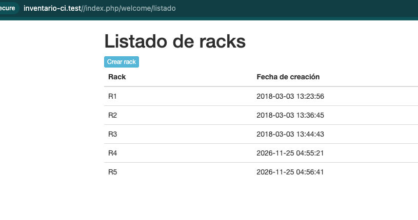
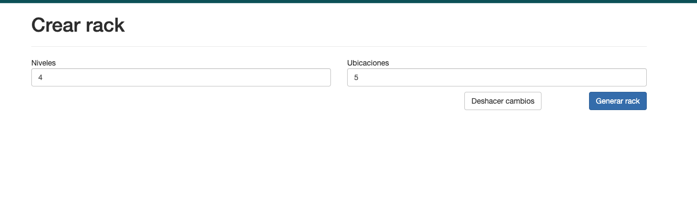
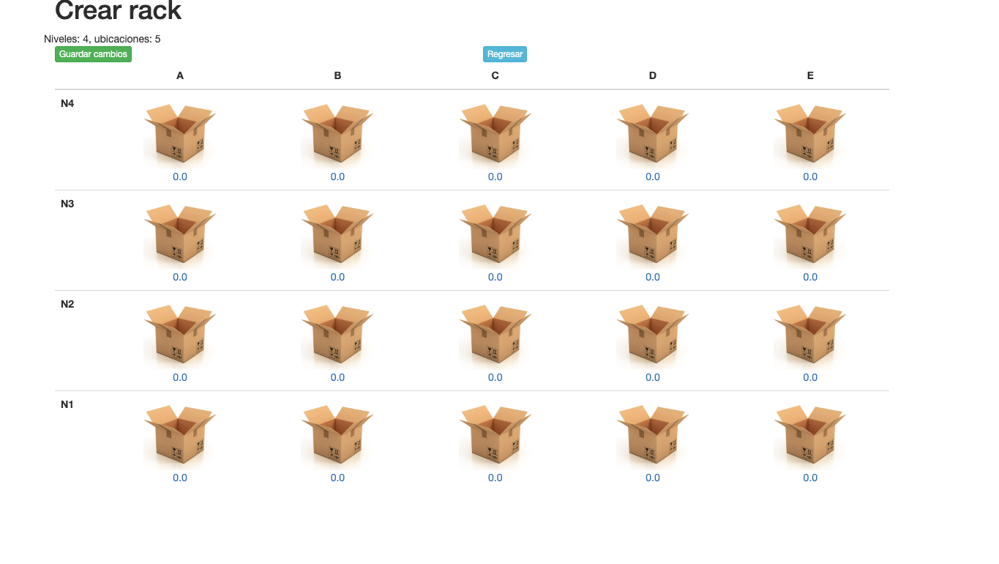
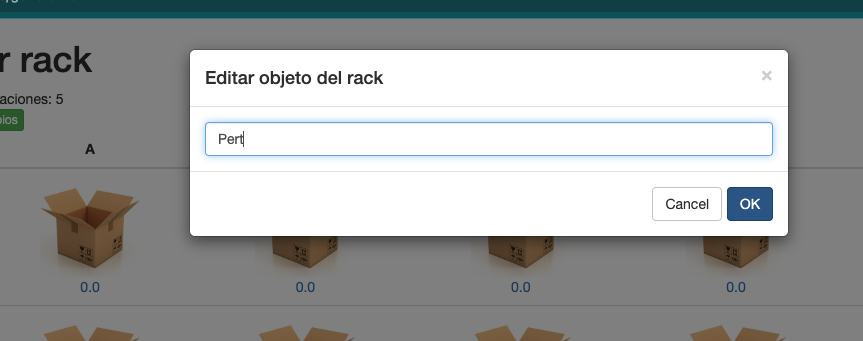

# Inventario

Aplicación web para localizar refacciones por número de parte y consultar o ajustar su existencia en cada posición de un rack. Usa PHP, CodeIgniter 3.1.7 y MariaDB o MySQL. La interfaz carga Bootstrap y jQuery desde CDN.

## Industria y casos de uso

Está pensada para operaciones de **almacenamiento físico**, como bodegas de distribución, trastiendas de comercios y almacenes de materiales en talleres o pequeñas plantas de manufactura. Sirve para representar estanterías con niveles y posiciones fijas y capturar un conteo inicial de cajas o unidades por posición. Por ejemplo, una bodega puede registrar que el rack `R4` tiene seis cajas en el nivel `N2`, columna `B`.

Cada posición admite una pieza y su conteo actual. La misma pieza puede estar almacenada en varias posiciones. Las compras, las órdenes de servicio y el historial de movimientos quedan fuera del alcance del ejercicio.

## Ejecutar en local

### Con Herd y Docker

1. Desde la raíz del repositorio, crea `.env` a partir de [`.env.example`](.env.example) si aún no existe. Asigna contraseñas distintas a `INVENTARIO_DB_PASSWORD` y `INVENTARIO_DB_ROOT_PASSWORD`. Conserva el puerto `3307` o elige otro puerto libre.
2. Ejecuta `docker compose up -d`. MariaDB escucha en `127.0.0.1:3307` con el puerto predeterminado. Al inicializar un volumen nuevo, Docker importa los datos de ejemplo y aplica la migración de refacciones. Si tu volumen ya tenía el esquema anterior, aplica la migración una vez desde la raíz:

   ```sh
   docker compose exec -T db sh -c 'MYSQL_PWD="$MARIADB_ROOT_PASSWORD" exec mysql -u root inventario' < application/database/20261124-autopartes.sql
   ```
3. Crea `application/config/development/database.php` con el siguiente contenido. Usa el puerto de `INVENTARIO_DB_PORT` y la misma contraseña que configuraste en `INVENTARIO_DB_PASSWORD`.

   ```php
   <?php
   defined('BASEPATH') OR exit('No direct script access allowed');
   require APPPATH.'config/database.php';
   $db['default']['hostname'] = '127.0.0.1';
   $db['default']['port'] = 3307;
   $db['default']['username'] = 'inventario';
   $db['default']['password'] = 'TU_CONTRASEÑA_LOCAL';
   $db['default']['database'] = 'inventario';
   ```

4. Crea `application/config/development/config.php` con la URL local.

   ```php
   <?php
   defined('BASEPATH') OR exit('No direct script access allowed');
   $config['base_url'] = 'http://inventario-ci.test/';
   ```

5. Con Herd en ejecución y PHP 7.4 instalado, registra el sitio y abre <http://inventario-ci.test/>.

   ```sh
   herd link inventario-ci
   herd isolate 7.4 --site=inventario-ci
   ```

Para detener la base conservando sus datos, ejecuta `docker compose stop`. Los archivos `.env` y los ajustes de desarrollo descritos arriba están excluidos de Git.

### Con el servidor integrado de PHP

#### Requisitos

- PHP CLI con las extensiones `mysqli` y `mbstring`. Para este proyecto legado, usa PHP 7.4 en un entorno local aislado.
- Un servidor MySQL en ejecución, el cliente `mysql` y un usuario con permisos para crear una base local e importar el respaldo.
- Acceso a los CDN desde el navegador para que funcionen los controles de la cuadrícula y el guardado.

#### Instalación y arranque

1. Abre una terminal en la raíz del repositorio, donde está `index.php`.
2. Crea una base de datos local **vacía** e importa el respaldo. Sustituye `TU_USUARIO_MYSQL` por tu usuario. El respaldo elimina y vuelve a crear las tablas `rack` y `ubicacion` e incluye datos de ejemplo.

   ```sh
   mysql -h localhost -u TU_USUARIO_MYSQL -p -e 'CREATE DATABASE inventario;'
   mysql -h localhost -u TU_USUARIO_MYSQL -p inventario < application/database/inventario-20180303.sql
   mysql -h localhost -u TU_USUARIO_MYSQL -p inventario < application/database/20261124-autopartes.sql
   ```

3. En [`application/config/database.php`](application/config/database.php), ajusta `hostname`, `username`, `password` y `database` en la conexión `default` según tu instalación. El nombre de la base creada en el paso anterior es `inventario`.
4. En [`application/config/config.php`](application/config/config.php), ajusta la URL para el servidor integrado de PHP.

   ```php
   $config['base_url'] = 'http://127.0.0.1:8000/';
   ```

5. Inicia el servidor desde la raíz y abre <http://127.0.0.1:8000/> en el navegador.

   ```sh
   php -S 127.0.0.1:8000
   ```

## Ejercicio para un almacén de refacciones automotrices

1. En **Crear rack**, indica al menos dos niveles y dos ubicaciones por nivel. Pulsa **Generar rack**.
2. Abre **Unidades** en `N2-B`. Captura `FIL-001`, la descripción «Filtro de aceite» y seis unidades. Guarda la ubicación, luego pulsa **Guardar rack** para registrar la cuadrícula.
3. Abre **Listado de racks** y busca `FIL-001`. Cada resultado muestra el rack, nivel, columna y unidades. Pulsa el nombre del rack para abrirlo.
4. Después de entregar dos filtros, edita `N2-B` y ajusta el conteo de seis a cuatro. Al reabrir el editor verás los datos guardados. Una pieza con cero unidades conserva su ubicación y aparece en la búsqueda.

Los racks anteriores conservan sus cantidades. Sus posiciones se muestran como «Sin pieza asignada» hasta que el operador registre la refacción.

[Propuesta OpenSpec](openspec/changes/inventario-autopartes-por-rack/proposal.md)

## Capturas de la versión anterior

Estas capturas documentan el flujo que motivó el ejercicio.

### 1. Listado de racks

El listado muestra el nombre y la fecha de creación. Las filas son informativas y carecen de enlaces para abrir el rack o consultar sus ubicaciones. **Crear rack** lleva al formulario de alta.



### 2. Formulario de alta

Indica cuántos niveles tendrá el rack y cuántas ubicaciones habrá por nivel. En la captura, **Generar rack** arma una cuadrícula de cuatro niveles por cinco ubicaciones.



### 3. Cuadrícula del rack

Cada caja representa una ubicación. Los niveles se identifican como `N1`, `N2`, etc., y las columnas con letras. El `0.0` que aparece bajo cada caja representa el conteo inicial de cero unidades. La interfaz muestra un decimal, aunque la base de datos guarda la cantidad como un entero.



### 4. Edición de una celda y guardado

Al pulsar el valor aparece el diálogo **Editar objeto del rack**. El campo permite escribir texto y lo muestra en la cuadrícula al confirmar. En la captura se introdujo `Pert`, pero al guardar el servidor intenta almacenar ese valor como cantidad entera. El editor vuelve a abrirse vacío porque carece de un valor precargado, incluso cuando la celda ya muestra el cambio.



Al pulsar **Guardar cambios**, si el alta se completa, se asigna un nombre consecutivo como `R4` y se vuelve al listado. Desde allí se puede iniciar otro rack. El flujo actual termina en ese listado.
